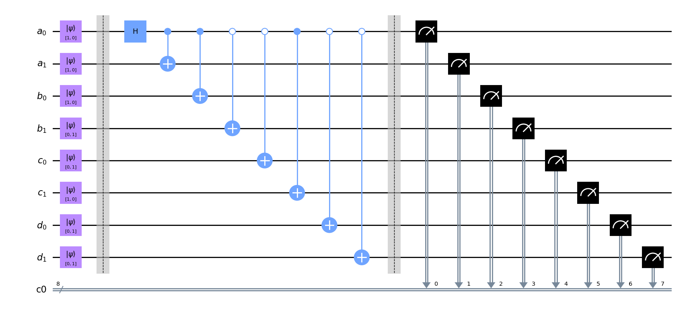
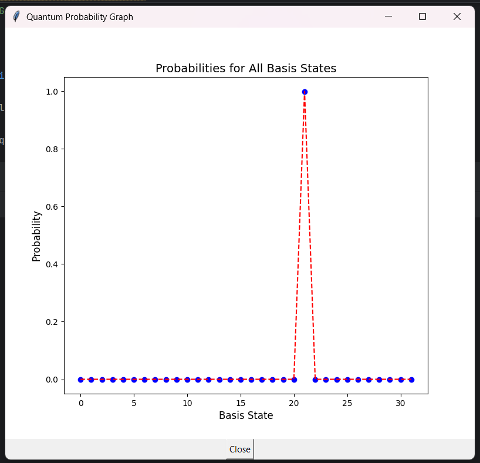

# Quantum Simulator



<div align="center">

  <h1 align="center">Quantum Simulator</h1>

  <p align="center">
    A didactic, pure-Python state-vector quantum simulator with a text-based circuit DSL
  </p>

  <p align="center">
    
    
    
    
  </p>
</div>

## Table of Contents

- [About the Project](#about-the-project)
- [Features](#features)
- [Installation](#installation)
- [Quick Start](#quick-start)
- [Command Language Reference](#command-language-reference)
  - [General Syntax](#general-syntax)
  - [Configuration Commands](#configuration-commands)
  - [Single-Qubit Gates](#single-qubit-gates)
  - [Two-Qubit Gates](#two-qubit-gates)
  - [Range-Aware Gates](#range-aware-gates)
  - [Utility Commands](#utility-commands)
  - [QFT / IQFT](#qft--iqft)
  - [Measurement](#measurement)
- [Example: Grover's Search on 5 Qubits](#example-grovers-search-on-5-qubits)
- [Architecture](#architecture)
  - [Data Representation](#data-representation)
  - [Execution Pipeline](#execution-pipeline)
  - [Endianness and Indexing](#endianness-and-indexing)
- [File Format Specification](#file-format-specification)
- [API Reference](#api-reference)
- [Troubleshooting](#troubleshooting)
- [History](#history)

---

## About the Project

> **Note**: the picture above represents a quantum circuit diagram with 8 qubits
> (Hadamard on `q[0]` and CNOT gates on all others).

**Quantum Simulator** is an educational, dependency-light quantum state-vector
simulator written in pure Python/NumPy. It is intentionally *transparent* rather
than optimized: every amplitude movement is explicit, qubit-range semantics are
preserved, and intermediate states can be printed or plotted for inspection.

Circuits are described in a small textual **DSL** (domain-specific language) —
one command per line, terminated by `;`. Each command names a gate or an
operation, optionally with a qubit range or a numeric parameter, and the
interpreter applies it in order to an `n`-qubit state vector using
**little-endian** indexing (qubit 0 is the least significant bit).

The project prioritizes:

- **Readability** — a reader can follow the math behind every gate directly in the code.
- **Reproducibility** — deterministic parsing and explicit state vectors make it easy to re-run a paper example.
- **Didactics** — verbose mode, probability plots, and marginal measurement post-processing help to *see* what a circuit does.

---

## Features

### Gates and operations

- **Single-qubit gates:** `id`, `h`, `x`, `y`, `z`, `s`, `sdg`, `t`, `tdg`, `sk`
- **Hadamard block:** `hn` — apply `H^{⊗n}` in a single sweep (fast path used internally by `h q[0:n-1]`)
- **Two-qubit gates:** `cx` (CNOT), `csk` (controlled phase with angle π/k)
- **Range expansion:** every gate accepts either `q[n]` or `q[a:b]` (inclusive), and the
  interpreter iterates over the range in the correct direction.
- **Utilities:** `reverse` (bit-reversal / endianness swap), `Sign` (selective phase inversion on a basis index)
- **QFT blocks:** `QFT` and `IQFT` over a contiguous qubit range
- **Initialization:** zero state, random complex superposition on a range, or modular-exponentiation state (`N&m`)
- **Measurement:** `measure q[a:b]` marks qubits; post-processing prints marginals and conditional states
- **Visualization:** static Matplotlib figure (`plot.png`) and optional Tkinter window

### Misc

- **Interactive launcher:** choose a `.txt` circuit file or generate a random one.
- **Verbose mode:** prints the full state vector after each gate.
- **Threshold filtering:** `Inverse_P_threshold N` prints only basis states with `P > 1/N`.

---

## Installation

```bash
git clone <your-repo-url>
cd quantum-simulator
pip install numpy matplotlib
```

**Requirements:**

| Package     | Purpose                              |
|-------------|--------------------------------------|
| `numpy`     | state vector arithmetic (required)   |
| `matplotlib`| `plot.png` generation (optional)     |
| `tkinter`   | interactive plot window (optional)   |
| `openai`    | imported but not used — safe to drop |

`tkinter` ships with standard CPython builds; on Linux you may need
`sudo apt install python3-tk`.

---

## Quick Start

```bash
python experiment.py
```

You will be prompted with a dialog:

```
1 to choose file,
2 to random generating
```

- **Option 1** — pick a `.txt` file with your circuit.
- **Option 2** — the simulator generates `random_test.txt` with 2–5 qubits and 3–7 random commands.

Then simply run:

```bash
python experiment.py path/to/circuit.txt
```

(Passing the path as a CLI argument skips the dialog.)

### Minimal example

Save as `bell.txt`:

```text
verbose 1;
h q[0];
cx q[0], q[1];
measure q[0:1];
```

Run it, and you'll see the state vector after each gate and, at the end, the
probabilities for `|00⟩` and `|11⟩`.

---

## Command Language Reference

### General Syntax

```
<gate> <arguments> ;
```

- Every line must end with `;`.
- Whitespace is ignored.
- Comments are **not** supported — use blank lines if you need visual separation.
- A qubit is referenced as `q[N]`; a contiguous range as `q[A:B]` (inclusive on both ends).
- If `A > B`, the range is iterated **downward** (the interpreter respects direction).

### Configuration Commands

| Command | Syntax | Effect |
|---|---|---|
| `verbose` | `verbose 1;` / `verbose 0;` | Enable/disable printing the state vector after each gate |
| `plot` | `plot 1;` / `plot 0;` | Save a probability histogram to `plot.png` and (optionally) open a Tkinter window |
| `printout` | `printout 1;` / `printout 0;` | Enable/disable the final basis-state table |
| `Inverse_P_threshold` | `Inverse_P_threshold 1000;` | Only print basis states with `P > 1/1000` |
| `init` | `init q[0:3];` | Initialize qubits to a random complex superposition on the given range |

> `init` sets `initial_state = -2`, which tells the simulator to fill the state
> vector with `random.uniform(-1, 1) + 1j·random.uniform(-1, 1)` for indices in
> `[2**qubit_start, 2**qubit_end]` and then renormalize.

### Single-Qubit Gates

| Gate  | Matrix | Notes |
|-------|--------|-------|
| `id`  | `I`    | Identity |
| `h`   | `1/√2 [[1,1],[1,-1]]` | Hadamard |
| `x`   | `[[0,1],[1,0]]` | Pauli-X |
| `y`   | `[[0,-i],[i,0]]` | Pauli-Y |
| `z`   | `[[1,0],[0,-1]]` | Pauli-Z |
| `s`   | `diag(1, i)` | Phase gate |
| `sdg` | `diag(1, -i)` | S† |
| `t`   | `diag(1, e^{iπ/4})` | T gate |
| `tdg` | `diag(1, e^{-iπ/4})` | T† |
| `sk`  | `diag(1, e^{iπ/k})` | S_k gate — syntax `sk q[n], k;` |

**Syntax:**

```
x q[0];
h q[0:4];
sk q[2], 8;          # S_k with k = 8 on qubit 2
```

### Two-Qubit Gates

| Gate  | Syntax | Description |
|-------|--------|-------------|
| `cx`  | `cx q[ctrl], q[target];` | CNOT — control and target can also be ranges |
| `csk` | `csk q[ctrl], q[target], k;` | Controlled phase `diag(1,1,1,e^{iπ/k})` |

For `cx`, ranges are allowed on **either** side, but not simultaneously on both
(see `extract_qubits` in `experiment.py`). Examples:

```
cx q[0], q[1];              # single control, single target
cx q[0:3], q[4];            # CNOT from q[0], q[1], q[2] to q[4]
cx q[0], q[1:4];            # CNOT from q[0] to q[1], q[2], q[3]
```

`csk` does **not** allow ranges at all (it exits with an error) — the gate is
defined for a single (control, target) pair.

### Range-Aware Gates

Any command that accepts `q[a:b]` applies the gate to **every** qubit in the
range, in order. If `a ≤ b`, iteration is ascending; if `a > b`, it is
descending. This makes it easy to write things like:

```
h q[0:4];        # H on qubits 0,1,2,3,4
x q[3:0];        # X on qubits 3,2,1,0 (reverse order)
```

When `h q[0:n-1]` is detected, the interpreter shortcuts to the internal
`hadamard_n()` — equivalent to applying `H` to every qubit in the range.

### Utility Commands

| Command | Syntax | Effect |
|---------|--------|--------|
| `Sign` | `Sign q[21];` | Multiply amplitude `state[21]` by `-1` — the Grover oracle |
| `reverse` | `reverse;` | Swap little-endian ↔ big-endian indexing |
| `N&m` | `N&m 3, 2;` | Initialize the state to `(m^k mod N)` (modular exponentiation) |

`N&m` sets `initial_state = -3`, which the loader uses to build the state
`state[k] = (m**k) % N` before normalization. This is the classic input to
Shor-style experiments.

### QFT / IQFT

```
QFT q[0:3];
IQFT q[0:3];
```

Applies the (inverse) discrete Fourier transform on the contiguous range
`[a, b]`, using the phase `exp(±2πi·j·k / N)` convention with `N = 2^(b-a+1)`.
Qubits outside the range are left untouched (the DFT is applied only on the
subspace spanned by the range).

### Measurement

```
measure q[0:4];
```

Marking a qubit for measurement **does not** collapse the state vector; the
simulator keeps the amplitudes and computes marginals during post-processing.
`calculate_results` prints, for each measurement outcome:

- the probability `P(bits)`,
- the conditional (renormalized) state `|psi>`.

This is a subtle but important design choice — it lets you inspect interference
patterns without introducing stochastic noise.

---

## Example: Grover's Search on 5 Qubits

The console output below corresponds to Grover's search with `N = 2^5 = 32`
and the marked state `index 21` (displayed as `|10101⟩` in little-endian).

**Input file `grover.txt`:**

```text
verbose 1;
plot 1;

h q[0:4];

Sign q[21];
h q[0:4];
Sign q[0];
h q[0:4];

Sign q[21];
h q[0:4];
Sign q[0];
h q[0:4];

Sign q[21];
h q[0:4];
Sign q[0];
h q[0:4];

Sign q[21];
h q[0:4];
Sign q[0];
h q[0:4];

measure q[0:4];
```

**What happens step by step:**

1. `h q[0:4]` — create the uniform superposition
   `|s⟩ = H^{⊗5}|00000⟩`.
2. Four Grover iterations — each is `O · D`, where:
   - `Sign q[21]` flips the phase of the marked state (oracle `O`),
   - `h q[0:4]; Sign q[0]; h q[0:4]` is the diffusion operator `D`.
   Four iterations is optimal for `N = 32`: `⌊π/4 · √N⌋ = 4`.
3. `measure q[0:4]` — marks all qubits and triggers the marginal print.

**Expected output (excerpt):**

```text
Initial state: |psi> = 
(1.000+0.000j)|00000>

Number of qubits: 5
Hadamard gate applied to qubits from 0 to 4
Sign flip on index 21
Hadamard gate applied to qubits from 0 to 4
...
Measure qubit 0
Measure qubit 1
Measure qubit 2
Measure qubit 3
Measure qubit 4

Final basis states with P > 0.0
...
P(|10101>) = 9.99e-01    Amplitude: 1.00e+00+0.00e+00j
...
P(10101) = 0.9991823155432863
|psi> = (1.000+0.000j)|10101>
```

The probability of the marked state is ≈ `0.999`, which matches the theoretical
`sin²((2k+1)·θ)` with `θ = arcsin(1/√32)` and `k = 4`.



---

## Architecture

### Data Representation

- The state vector is a `np.ndarray` of shape `(2**num_qubits,)` with
  `dtype=complex128`.
- Index `j` encodes the computational basis state: qubit `q` corresponds to bit
  `q` of `j`.
- `num_qubits` is inferred automatically by scanning the circuit for the highest
  qubit index mentioned in any command.

### Execution Pipeline

```
┌─────────────────────┐
│ choose_option()     │  → file dialog or random test
└──────────┬──────────┘
           ▼
┌─────────────────────┐
│ read command_list   │  (UTF-8, one command per line)
└──────────┬──────────┘
           ▼
┌─────────────────────┐
│ pre-scan pass       │  → determine num_qubits,
│                     │     verbose/plot/print flags,
│                     │     initial_state, N&m params
└──────────┬──────────┘
           ▼
┌─────────────────────┐
│ initialize state    │  → |0…0⟩, random, or (m^k mod N)
└──────────┬──────────┘
           ▼
┌─────────────────────┐
│ for command in list │  → dispatch to gate function
│   apply gate        │     (prints if verbose)
└──────────┬──────────┘
           ▼
┌─────────────────────┐
│ calculate_final_    │  → basis-state table filtered by
│ results             │     Inverse_P_threshold
└──────────┬──────────┘
           ▼
┌─────────────────────┐
│ calculate_results   │  → marginal probabilities &
│ (if any measure)    │     conditional states
└──────────┬──────────┘
           ▼
┌─────────────────────┐
│ plot_results /      │  → plot.png + Tkinter window
│ plot_tkinter        │
└─────────────────────┘
```

### Endianness and Indexing

The simulator uses **little-endian** ordering:

- qubit `0` ↔ least-significant bit of the index,
- `"{:0{n}b}".format(j)[::-1]` is used everywhere to produce the display string.

So basis index `21` (binary `10101`) is printed as `|10101⟩` — but note that
in this display, the leftmost character is qubit 4 and the rightmost is qubit 0.

If you need big-endian display, use the `reverse` command.

---

## File Format Specification

A circuit file is a plain-text file, UTF-8 encoded, one command per line:

```
<gate> [<args>] ;
```

- **No comments** — any non-command line will be ignored (but the parser may
  complain if `;` is missing).
- **Case-sensitive** gate names.
- **Blank lines** are ignored.
- **Semicolons are mandatory** — `command.rpartition(";")` drives parsing.

Example of the full command set exercised in a single file:

```text
verbose 1;
plot 1;
printout 1;
Inverse_P_threshold 1000;
init q[0:2];

h q[0:2];
t q[0];
cx q[0], q[1];
csk q[1], q[2], 4;
sk q[0], 8;

QFT q[0:2];
IQFT q[0:2];

Sign q[3];
reverse;

measure q[0:2];
```

---

## API Reference

The simulator is a flat script (not a package), but the key functions are
self-contained and can be imported for experimentation.

### Gate functions

All follow the signature `gate(num_qubits, qubit, state) → np.ndarray`:

| Function | Gate |
|---|---|
| `identity_gate(n, q, s)` | `I` |
| `hadamard_gate(n, q, s)` | `H` |
| `hadamard_n(n, s)` | `H^{⊗n}` |
| `pauli_x(n, q, s)` | `X` |
| `pauli_y(n, q, s)` | `Y` |
| `pauli_z(n, q, s)` | `Z` |
| `phase_gate(n, q, s)` | `S` |
| `phase_dagger_gate(n, q, s)` | `S†` |
| `t_gate(n, q, s)` | `T` |
| `t_dagger_gate(n, q, s)` | `T†` |
| `sk_gate(n, q, k, s)` | `S_k` |
| `controlled_x(n, c, t, s)` | `CX` |
| `controlled_sk(n, c, t, k, s)` | `CS_k` |
| `sign_flip(n, i, s)` | sign flip on basis index `i` |
| `reverse_state(n, s)` | bit reversal |
| `dft(n, a, b, type, s)` | QFT (`type=1`) / IQFT (`type=-1`) |

### Post-processing

- `calculate_final_results(num_qubits, state, probability_threshold)` —
  prints basis states with probability above the threshold.
- `calculate_results(num_qubits, state, measurement_array)` — prints marginal
  probabilities and conditional states for measured qubits.
- `plot_results(num_qubits, state)` — saves `plot.png`.
- `plot_tkinter(num_qubits, state)` — opens a Tkinter window with the plot.

### Utility

- `extract_qubits(command)` — parses a command into
  `(control_start, control_end, target_start, target_end)`.
- `set_bit(value, bit_index)` / `clear_bit(value, bit_index)` — bit helpers.
- `dft_j(type, N, j)` — single-column DFT coefficient vector.

---

## Troubleshooting

**`Encoding error in 'file'. Ensure it's UTF-8 encoded.`**
The file contains non-UTF-8 bytes. Re-save as UTF-8 (most editors have
"Save As → UTF-8").

**`FileNotFoundError`**
You passed a path that doesn't exist. Run from the directory containing the
circuit, or use an absolute path.

**`The csk gate does not allow expansion of range of qubits`**
`csk` accepts only single qubits: `csk q[1], q[2], 4;` — not `csk q[0:1], q[2], 4;`.

**State looks different from what I expected**
Remember: little-endian display. The first character of the binary string is
qubit `n-1`, and the last is qubit `0`. Use `reverse;` to swap.

**`plot.png` not generated**
`plot 1;` must appear in the file. Also, Matplotlib must be installed.

**Tkinter window does not open**
Headless environment or missing `python3-tk`. The static `plot.png` is still
produced.

**Output is too verbose**
Set `verbose 0;` and/or `printout 0;` at the top of your circuit file.

---

## History

This quantum simulator began as a student research project for the
**Scientific-Research Work of Students (НИРС)**. The competition's
documentation template emphasized formal reporting more than reproducible
code, so the original deliverables were not ideal for sharing or extending.
This repository is the cleaned-up, runnable version.

> **NOTE**: The complete technical explanation of the project and the
> theoretical foundations are in the attached PDF file.

---

## License

MIT — free for educational and research use.  
